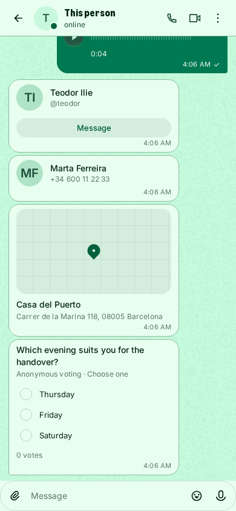
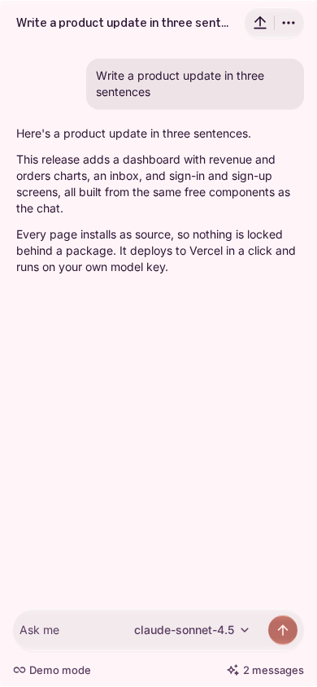

# Issue #663: chat route smoke evidence

Date: 2026-11-11 (UTC)

This is narrow interaction evidence for the existing checklist item requiring a person-to-person Allo chat and an assistant/agent conversation or equivalent fixture. It does not claim mobile-native parity, full composer acceptance, package adoption on Allo's current main, or general chat consolidation.

## Person-to-person route in Allo

- Repository: `OxyHQ/Allo`, clean detached worktree at `629fa549975b7492f2cde0fdce319fa6e6c6d7f4` (`origin/main` at capture time).
- Resolved `@oxy.so/bloom` package: `17.19.3`.
- Ran the app's `ALLO_HARNESS=1` web route locally at `http://localhost:8167`.
- Opened a seeded one-to-one conversation between Teodor Ilie and Marta Ferreira. The visible thread contained text, a link, attachment, audio, location and poll content, with the message composer present.
- No page errors or non-localhost requests were observed during the route capture.
- This confirms the actual human-to-human route renders on Allo main, but against its currently pinned Bloom package version; it is not evidence of adoption of Bloom 17.22.0.

## Assistant/agent route in Bloom's equivalent fixture

- Bloom revision: source tree at the time of capture, branch `codex/issue-663-public-part-audit`.
- Storybook story: `Patterns/Agents/Agent Chat / Demo` (`agents-agent-chat--demo`) on a 390 × 844 viewport.
- Submitted “Write a product update in three sentences”; the fixture added the user message and streamed its scripted assistant reply to completion.
- No page errors or non-localhost requests were observed.
- This is explicitly a scripted Bloom fixture, not a live model or Alia production route.

