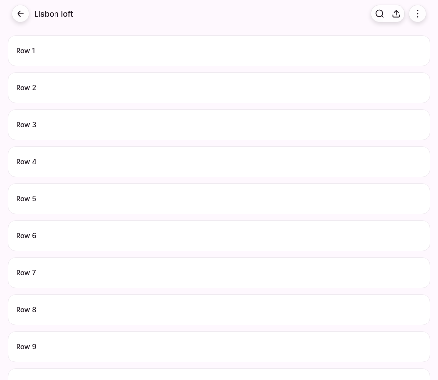
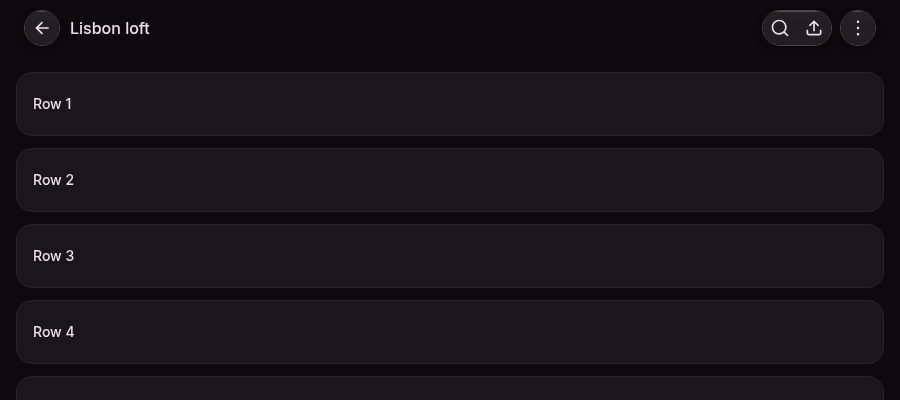
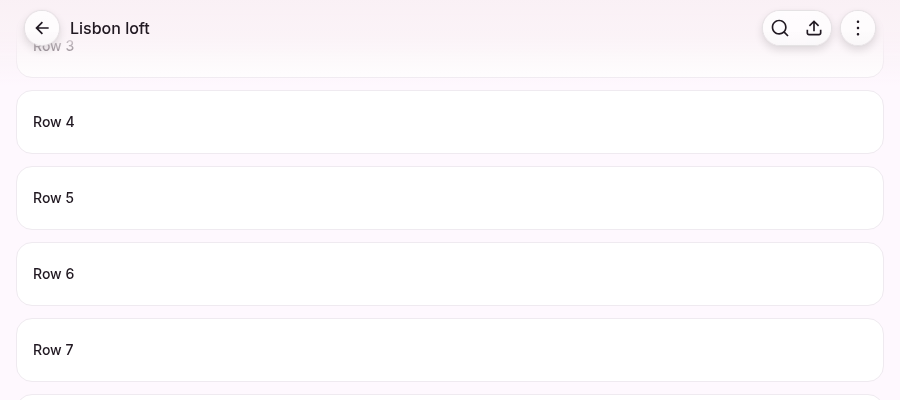
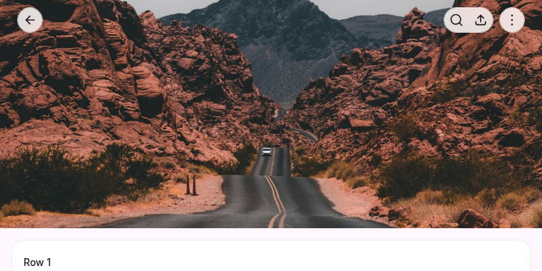

# PageHeader

```tsx
import { PageHeader } from '@oxy.so/bloom/page-header';
import { ButtonGroup, ButtonGroupItem } from '@oxy.so/bloom/button-group';

<PageHeader
  onBack={router.back}
  title="Lisbon loft"
  actions={
    <ButtonGroup accessibilityLabel="Page actions">
      <ButtonGroupItem iconOnly leadingIcon={RiSearchLine} accessibilityLabel="Search" />
      <ButtonGroupItem iconOnly leadingIcon={RiShare2Line} accessibilityLabel="Share" />
    </ButtonGroup>
  }
/>
```

Router-agnostic: the header never imports a router. With an `onBack`, the back button renders and calls it; an explicit `onBack` takes priority over the screen's own Back and remains enabled at a panel's history root. Without one, a header positioned by a `Screen` offers the screen's Back: a panel `navigation` history's while it can go back, otherwise the app's route Back (`BloomProvider back`, configured once — see [BloomProvider](/docs/provider)), which goes back through the router or to the app's fallback when a deep link left no history. Root pages of the tab pager, overlays and nested screens have no route Back. `onBack={null}` shows no back button on an app's other top-level destinations. `useScreenBack()` from `@oxy.so/bloom/screen` returns the same Back for content that navigates back itself.

For compact panel chrome, `density="compact"` uses a 32pt minimum row and 12pt
side insets without vertical padding. Larger controls, text and accessories grow
the header naturally; its measured height continues to own content clearance.
The default retains its 56pt minimum, 8pt vertical padding and responsive side insets.

## Navigation presentation

`presentation="navigation"` uses the same header renderer and Screen clearance
contract for a compact document-navigation row: 44pt minimum height, 12pt side
insets, no vertical padding and a 2pt action gap. Larger content and safe-area
insets still grow its measured height. Existing `floating`, `bar` and
`density="compact"` presentations retain their geometry.

The row provides `BloomScope controlDensity="compact"`, independently of app
size. A normal `md` Button is 28pt high with a 14pt label on desktop; native and
coarse-pointer actions expand to 44pt. `appearance="plain"` is an explicit
choice for quiet actions; the header does not replace their material or tone.
OverlayRoot and ScreenScope start a fresh control-density environment, so a
dialog opened by a header action keeps ordinary form-button geometry. Explicit
Button `density` overrides its nearest scope.

```tsx
<PageHeader
  presentation="navigation"
  title={<Breadcrumb overflow="collapse" separator="/">…</Breadcrumb>}
  actions={<Button appearance="plain" tone="neutral" onPress={openShare}>Share</Button>}
/>
```

## Actions that adapt to their container

`actions` accepts either its existing `ReactNode` or a render function receiving
`PageHeaderActionsState`: `{ compact: boolean; spacious: boolean }`. Compact means the header's own
width is below `BREAKPOINTS.sm` (640px), including a narrow panel in a wide window.
`spacious` means the header container is at least `BREAKPOINTS.xl` (1280px), suitable
for optional activity metadata before the actions. Both are independent of `density` and inherited control size: normal app controls
still use `md`.

```tsx
<PageHeader
  title={<Breadcrumb overflow="collapse">…</Breadcrumb>}
  actions={({ compact }) => (
    <>
      {!compact && <Button key="favorite" iconOnly icon={RiStarLine} accessibilityLabel="Favorite" />}
      <Button
        key="share"
        iconOnly={compact}
        icon={compact ? RiShare2Line : undefined}
        accessibilityLabel="Share"
        onPress={openShareDialog}
      >
        {!compact ? 'Share' : undefined}
      </Button>
    </>
  )}
/>
```

Use compact mode to shorten a label or omit a secondary action already available
in an action menu. Keep accessible names, component types and keys stable: the
function resolves inside the same actions slot, so an action's open dialog and
edited state can survive a width change. Do not return separate compact/full
component trees or mount two copies. Header-supplied host actions remain alongside
the resolved screen actions.

On web, the existing header `onLayout` stores only these tier booleans and updates
them when crossing their boundaries; continuous container resizing does not publish
pixel widths to React. Before the first web measurement, actions use the compact
form. Native reuses the header's existing width measurement and window seed.
Static node actions retain their existing behavior.

## The default is floating

The header is no longer a strip. The back button sits in its own translucent capsule, the actions you declared as a group share one island, the title floats between them, and the whole thing ends in a soft vertical gradient rather than a hairline. Content passes under it.

```
  ( ← )            Lisbon loft            ( ⌕  ↗ )   ( ⋯ )

  its own island                          one island  another
```

Three things that used to be one flag are three props now:

| prop | default | |
| --- | --- | --- |
| `presentation` | `'floating'` | `'bar'` is the original opaque strip; `'navigation'` is the compact navigation row. |
| `placement` | `'inline'` | `'overlay'` floats the header over the content. |
| `scrim` / `titleReveal` | `'auto'` / `'auto'` | the edge effect and the title, decided separately. |

### The islands are yours to declare

The header never infers grouping from its children's types. The `actions` slot is wrapped in a `BloomScope` with shared control defaults, so a `ButtonGroup` placed there becomes one island with no prop written on it, two `ButtonGroup`s become two islands, and a `Button` keeps its own chrome — which is what a primary action in its own accent capsule should do.

```tsx
actions={
  <>
    <ButtonGroup accessibilityLabel="Page actions">
      <ButtonGroupItem iconOnly leadingIcon={RiSearchLine} accessibilityLabel="Search" />
      <ButtonGroupItem iconOnly leadingIcon={RiShare2Line} accessibilityLabel="Share" />
    </ButtonGroup>
    <Button appearance="solid" tone="accent" size="md">Save</Button>
  </>
}
```

For an icon action that should sit flush on an island, use `ButtonGroupItem` — a `Button` paints its own fill and would read as a card inside the capsule. The full rule is in [Composition](/docs/composition).

### The edge effect

A vertical gradient of the page colour, fading to nothing **below** the header's own box — the ramp is 1.55× the header's height, so it finishes past the layout rather than at it. That overhang is the point: a translucent rectangle ends at its own bottom edge, and that edge is a line across the screen whether or not it is drawn.

It is an opacity ramp of one flat colour, not a blur of varying intensity. `backdrop-filter` and `expo-blur` both take a single radius for a whole surface; a real blur falloff needs the stacked layers `progressive-blur` uses, and is not what this is.

`scrim="auto"` fades it in over `[0, scrollThreshold]`, so it appears when content starts passing under. `"always"` paints it at rest — for a header born over a photograph. `"none"` removes it and leaves legibility to the islands alone.

**The colour follows the containing surface.** The ramp inherits the fill published by ContentPanel/SurfaceLevelProvider, falling back to the page background. A custom background unknown to that context must publish its resolved fill (for a panel, `surfaceColor`) or explicitly pass `scrimColor`. Pass an **opaque** colour: the alpha belongs to the ramp, and a colour carrying its own would multiply with it.

**The islands protect themselves; the title does not.** An island carries its own material and is legible over both ends of the backdrop range (measured, in [Blur](/docs/blur)). A title is bare text on whatever is behind it, and with `scrim="auto"` there is nothing behind it until the page scrolls. So a header that sits over a photograph **at rest** needs a declared heading relationship or a choice that keeps its title readable:

- `titleReveal="auto"` (default) — a declared heading offset or registered docking section supplies the relationship automatically. Without that relationship, the title stays visible.
- `titleReveal="onScroll"` — the photo already names the screen, and the title arrives with the scrim. This is what the hero pattern wants.
- `scrim="always"` — the title is the name of the screen and must be readable from the first frame, so the gradient is there from the first frame too.

When the photo has no declared heading or docking relationship, choose an explicit reveal mode or a persistent scrim. The header cannot infer text inside arbitrary images.

### The same edge at the bottom

Chrome that floats at the BOTTOM of a scroller — a pinned composer, a reply prompt — gets the same edge effect from `EdgeScrim`, exported beside the header. `edge="bottom"` mirrors the ramp: the colour is solid at the bottom and fades to nothing above. Never paint such a footer with a solid fill: a rectangle ends at its own top edge, and that edge is the line this effect exists to remove.

```tsx
import { EdgeScrim, SCRIM_TAIL_RATIO } from '@oxy.so/bloom/page-header';
import { useSurfaceFill } from '@oxy.so/bloom/styles';

const surfaceFill = useSurfaceFill();

// Inside a footer that is `position: absolute` / `sticky` at the bottom.
<View pointerEvents="none" style={{ position: 'absolute', left: 0, right: 0, bottom: 0, top: -footerHeight * SCRIM_TAIL_RATIO }}>
  <EdgeScrim edge="bottom" color={surfaceFill} />
</View>
```

The scrim sizes to its parent, so the parent carries the height — extend it ABOVE the footer by `SCRIM_TAIL_RATIO` for the same reason the header extends below itself: the fade must finish past the layout, not at it. The colour follows the same rule as `scrimColor`: opaque, and the surface the content is scrolling on.

## Props

| Prop | Default | |
| --- | --- | --- |
| `title` | — | A string is the heading (`role="heading"`, `aria-level={headingLevel}`); a node renders as-is and owns its semantics. |
| `subtitle` | — | A string is a secondary line; a node renders as-is. |
| `titleAlign` | `'start'` | `'center'` centres the title on the container whatever the two sides hold. |
| `headingLevel` | `1` | |
| `titleReveal` | `'auto'` | Follows a declared heading offset or registered docking section; otherwise remains visible. Explicit modes override it. |
| `density` | `'default'` | `'compact'` uses a 32pt minimum, zero vertical padding and 12pt side insets; measured content may grow. |
| `presentation` | `'floating'` | `'bar'` for the flat strip; `'navigation'` for compact document chrome. |
| `placement` | `'inline'` | `'overlay'` positions the header over the content and claims the top edge. |
| `onBack` / `backLabel` | the screen's Back / `"Back"` | `null` hides the back button. `backLabel` is the button's accessible name — localise it. |
| `leading` | — | After the back capsule, before the title (an avatar, a logo). |
| `actions` | — | End of the bar. Floating: wrapped in a blur `BloomScope`. |
| `scrim` | `'auto'` | `presentation="floating"` only. `auto` \| `always` \| `none`. |
| `scrimColor` | Inherited surface fill | The opaque colour the edge effect fades from. Pass it when the screen paints a background the theme does not know about. |
| `border` | `'auto'` | `bar` and `navigation` only. `auto` fades the separator in with scroll; `always`; `none`. |
| `transparent` | `false` | `bar` and `navigation` only: background and shadow fade in with scroll. It no longer hides the title. |
| `scrollY` | — | A Reanimated `SharedValue<number>`. Omitted, reads HeaderDock, ScrollMetrics, Screen, ScrollOffsetProvider, then the web window fallback. |
| `scrollThreshold` | `20` | The offset over which the scroll-linked paint arrives. Over a hero, use the hero height minus the bar. |
| `sticky` | `true` | Web, `placement="inline"`: `position: sticky; top: 0`. No effect on native or on an overlay. |
| `safeArea` | native `true`, web `false` | Pads the top by the safe-area inset (read from `SafeAreaInsetsContext`; no provider → 0). |

A centered `title` may be a composed identity, such as `AgentProfile` with an
avatar and name. Its content participates in layout and sets the header height.
The measured navigation and action widths reserve symmetric space on either
side; callers do not need an absolute wrapper or a fixed header height. Node
titles own their accessible semantics.

Web widths stay in CSS: a container query chooses 16px/24px side insets and
`clamp()` preserves the centered title's 96px floor. Resizing a panel does not
copy every new width into React state. Only changed side-content measurements
and actual header-height changes update React; native retains its measured
container-width geometry.

## Look

- Default minimum height 56; compact minimum 32. Default side inset 16 below `sm`, 24 from `sm`; compact inset 12 — measured against the header's **container**, not the window, so a narrow desktop panel gets the narrow inset.
- Islands are 36 tall (a 34 control plus the hairline), 8 apart. The back capsule carries 4px of hit slop on every side, which makes it a 44pt target with nothing beside it to steal from. **A grouped item is 34 × 34 with no slop** — items in a group are adjacent, and slop on one overlaps its neighbour. Where the 44pt floor matters for every action, give each one its own island instead of grouping them.
- Island material: the shared Surface material. Default fills paint at 72% on the web, where the blur shows through, and opaque on native. See [Surface](./surface.mdx).
- Title `headline-medium` text-primary, subtitle `body-2-regular` secondary. Both truncate to one line.
- `bar`: background `background/full` (card; dark neutral-925), separator 1px (neutral-200; dark neutral-800), shadow `shadow-xs` once scrolled.
- No press scale. Every fade is scroll-linked, not timed, so there is no motion to reduce.
- **RTL** is structural rather than handled: the bar is a `flexDirection: 'row'`, which React Native mirrors, and the centred title's inset is the *wider* of the two sides applied to *both*, so it is symmetric by construction and has no side to get backwards.

## Placement, and who reserves the space

**`inline`** — the header is a sibling above the content in a column. It occupies layout; nothing passes under it and nothing needs padding. On web it is `position: sticky` unless you pass `sticky={false}`.

**`overlay`** — the header is absolutely positioned over the content, which starts at the top of the container and scrolls under the islands. The header then claims its measured height on the top-edge registry, and the content reads it:

```tsx
import { useTopEdgeInset } from '@oxy.so/bloom/layout';

function Screen() {
  const inset = useTopEdgeInset();
  return (
    <View style={{ flex: 1 }}>
      <ScrollView contentContainerStyle={{ paddingTop: inset }}>…</ScrollView>
      <PageHeader title="Inbox" onBack={router.back} placement="overlay" actions={…} />
    </View>
  );
}
```

`BloomProvider` already mounts `TopEdgeProvider`. The height is **measured**, not computed from a constant plus the insets — a subtitle, an enlarged font and a notch all move it, and a computed height fails silently, with content starting a few points under the islands as if that were the design.

The claim registers in an effect, so a reader mounted in the same commit sees `0` on its first render. The header narrows that to one frame by claiming its resting height (safe area + 56 by default, or + 32 for compact density) immediately.

Apply the safe area **once**: the header pads itself by `insets.top` on native, and the content's padding comes from the claim, which already includes it. Do not add `insets.top` again in the scroll container.

## Scroll

Everything scroll-linked interpolates over `[0, scrollThreshold]` of the resolved offset. The header resolves it in this order:

1. the `scrollY` prop,
2. the enclosing `HeaderDockProvider` offset,
3. the nearest `ScrollMetricsProvider` offset,
4. the enclosing `Screen` offset,
5. the nearest `ScrollOffsetProvider` (`@oxy.so/bloom/layout`),
6. `window.scrollY` — **web only**.

On native without one of these owners, the header stays at rest.

```tsx
import { ScrollOffsetProvider } from '@oxy.so/bloom/layout';

const scrollY = useSharedValue(0);
const onScroll = useAnimatedScrollHandler(
  { onScroll: (e) => { scrollY.value = e.contentOffset.y; } },
  [scrollY],
);

<ScrollOffsetProvider value={scrollY}>
  <PageHeader title="Inbox" onBack={back} sticky={false} />
  <Animated.ScrollView onScroll={onScroll} scrollEventThrottle={16}>…</Animated.ScrollView>
</ScrollOffsetProvider>
```

The context is what makes a desktop panel work: `window.scrollY` never moves inside a fixed shell, so a header following it looked deliberately inert. Name `scrollY` in the handler's dependency array — without the worklets Babel plugin (Storybook, some web builds) a shared value missing from it never updates.

**Over media:** let the photo start under the chrome (`placement="overlay"`, or a negative margin on the hero), and set `scrollThreshold` to the hero height minus the bar so the scrim arrives as the photo leaves. Add `titleReveal="onScroll"` if the photo already names the screen.

## Accessibility

- The title is a `heading` (level 1 by default: the page header titles the page).
- The container carries no landmark role. `role="banner"` would be one banner per header, and an app shell already owns the page's banner; a page header inside `main` is not a landmark in HTML either.
- The back button is named by `backLabel`. Its island carries no `role="group"` — a group of one is a container a screen reader steps into for nothing.
- The gradient is `pointerEvents: none` and is not in the accessibility tree. The bar and the actions row are `box-none`, so the gaps between islands stay transparent to touch — a floating header covers content it does not own, and an invisible rectangle that swallowed presses across the screen would be total and silent.
- Islands follow reduced transparency through the shared material (opaque bodies, no backdrop filter). Explicit alpha remains a caller choice.

## Platform notes

- **Web.** Shared Surface CSS: a 72% body over a frosted backdrop and a masked edge light. There is no SVG displacement; without backdrop-filter support, the body and decorative rim remain.
- **iOS and Android.** Shared SurfacePaint draws the body opaque, with the edge light as inset shadows and no per-surface blur. Outer shadows remain unclipped.









**Not verified on a device.** The historical measurements above are Chrome on Linux. Native geometry, safe-area padding and scroll linkage still need device verification; native SurfacePaint does not refract the backdrop.

## The window's title area

In a `Screen` header that is the window's chrome ([Window](/docs/window)) the
bar is the window's toolbar row: `windowToolbarHeight(metrics)` tall (52 on
OxyOS), with no vertical padding and no safe area above it, so its row is
centred on the window's controls whatever the presentation or density. It
starts at the larger of its side inset and the room the window's controls
take from its leading edge, so its background, scrim and hairline still run
under the controls. A centred title clears the room as well. On the web the
side inset is an `!important` stylesheet rule, so the room is a custom property
(`--bloom-page-header-window-room`) that a more specific rule reads, never an
inline padding. Anywhere else the header is unchanged.

**Its history is one group.** A window toolbar whose screen has a panel
`navigation` ([Compose application layouts](/docs/bloom/main/compose-layouts))
shows back and forward as one `ButtonGroup` at its leading edge (a Mac's
Finder and System Settings), never the lone back capsule: each is disabled
while its direction has nowhere to go, both at the history's root, and
`Mod+[` / `Mod+]` move through the same history while the screen is in front
(a menu declaring those chords hears them first). An explicit `onBack`, or
`null`, still wins; off a window the history is the lone Back as before.

## Not included

- **iOS large title.** A large title that collapses into the bar needs to live inside the scroll content (so it scrolls under the chrome) while the chrome lives outside it; a standalone header cannot own both without making content move at twice the scroll speed on native. `Dialog`'s own header ([Dialog](/docs/dialog)) does it because the Dialog owns its scroller.
- **Adaptive overflow.** Actions that do not fit are not collapsed into a menu. Declare fewer islands, or a menu of your own.

## Migrating to 3.0

**The default presentation changed.** A `<PageHeader>` with no `presentation` was a flat opaque bar and is now floating. Two ways forward:

- Keep the old look: add `presentation="bar"`. Everything else about that header is byte-for-byte what it was.
- Take the new one: the header is transparent, so make sure something is behind it. Either leave `placement="inline"` (the page colour shows through, which looks like the old bar minus the strip) or move to `placement="overlay"` and pad the content with `useTopEdgeInset()`.

**`transparent` no longer hides the title.** It faded the background in with scroll AND held the title back; those are `transparent` and `titleReveal="onScroll"` now. A header that wants the old combined behaviour passes both. A header that only ever wanted the fading background gets it without losing its title.

**`border` and `transparent` apply to `bar` and `navigation` only.** They are ignored by the floating presentation, which has no strip and no separator; `scrim` is its counterpart.

**Icon actions want `ButtonGroupItem`.** A `Button appearance="outline" tone="neutral"` in a floating header's actions paints its own shared translucent Surface. It still works; it is just not the shape the islands are for.

## Migrating from app headers

Mention, Allo and Homiio each hand-roll a `Header` with an `options` object. The mapping:

| App header | `PageHeader` |
| --- | --- |
| `options.title` | `title` |
| `options.titlePosition: 'left' \| 'center'` | `titleAlign: 'start' \| 'center'` |
| `options.subtitle` (string or node) | `subtitle` |
| `options.showBackButton` (+ `useSafeBack` / `router.back` inside) | nothing, with `BloomProvider back={useBackWithFallback('/')}` — `onBack={null}` to hide |
| Homiio `showBackButton && router.canGoBack()` | `onBack={router.canGoBack() ? router.back : undefined}` |
| `options.leftComponents: ReactNode[]` | `leading={<>…</>}` |
| `options.rightComponents: ReactNode[]` | `actions={<>…</>}`, grouped into `ButtonGroup`s |
| `hideBottomBorder` | `presentation="bar"` + `border="none"` |
| `disableSticky` | `sticky={false}` |
| web `window.scrollY > 20` sticky state | built in (`scrollThreshold`, default 20) |
| Homiio `options.transparent` / `options.scrollThreshold` | `presentation="bar" transparent titleReveal="onScroll"` / `scrollThreshold` |
| Homiio `scrollY` | `scrollY`, or a `ScrollOffsetProvider` around the screen |
| Homiio `useSafeAreaInsets().top` | `safeArea` (default on native) |
| Mention `options.headerTitleStyle` | pass a node `title` |


The default scrim and bar background inherit the containing surface’s published
fill (`SurfaceLevelProvider` / `ContentPanel`), falling back to the page
background outside a surface. An explicit `scrimColor` still overrides the fade.
The header’s outer box should span that surface; its own title/action padding
provides the interior spacing.


### Reveal after an in-content heading

`titleRevealOffset={headingHeight}` holds both title and subtitle until that scroll distance, then fades them in across `titleRevealDistance` (defaults to `scrollThreshold`, 20px). The scrim remains independent. Hidden header titles leave the accessibility tree until they start appearing; back and action islands remain available.

Measure the in-content heading block with its `onLayout` and pass its height as `titleRevealOffset` when it is the first block below the header. For later headings include the preceding content height. `Screen` and `ScreenScrollView` supply the shared offset; no consumer scroll listener is needed. See **Blocks / Page Header / Reveal After Content Heading** for the complete live composition. An omitted offset does not imply a duplicated content heading.

### Banner and docked tabs

Use `placement="overlap"` inside `HeaderDockProvider` when a banner should flow
behind the header. Unlike `overlay`, it retains document stickiness on web.
Pair it with `StickySection` from `@oxy.so/bloom/layout`: the section docks below
the measured header and both converge to the inherited opaque surface fill.
The default `titleReveal="auto"` reveals the title and subtitle with this shared docking
progress once the section has registered, without an application scroll threshold. At rest the hidden title is
also excluded from accessibility and hit testing. It requires a docking provider
and section; without a target the title remains hidden.

The provider accepts the existing `scrollY` shared value or inherits `Screen`'s.
Native lists retain sticky ownership and consume `useHeaderDockInset()` as their
supported sticky-header offset; see [layout](./layout.mdx). Storybook's
**Profile Docking** demonstrates the document-scroll composition.

For a native list behind the header, use `placement="overlay"` and let the list
consume `useHeaderDockInset()` for sticky clearance. This absolute header has
both a local stacking index and native elevation: Android scroll surfaces can
otherwise paint over its controls. `placement="overlap"` is the document-scroll
composition for web. Keep the header and list in the same unclipped parent;
no descendant elevation can escape an ancestor's clipping bounds.

For a header and footer around the same bounded scroller, wrap all three in
`ScrollMetricsProvider`, render `ScrollArea` for the content and set both scrims
to `auto`. The provider supplies the local offset to the header and the remaining
content distance to the footer. It takes precedence over an enclosing Screen's
scroll owner, so a nested panel follows its own content. See `layout.mdx` for
list bindings and resizing behavior.


`titleRevealOffset` and `titleRevealDistance` also accept Reanimated shared values.
Use these when the title block is measured on the UI thread: the header responds
to the measurement without copying each scroll frame into React state. Dialog's
navigation header uses this same API, `PageHeader` and `ButtonGroup`; dialog
screens do not maintain a separate chrome renderer. `tone="onImage"` selects
light title and supporting text while the action islands keep their own material.


### Automatic title reveal

`PageHeader` defaults to `titleReveal="auto"`. A supplied `titleRevealOffset`
pairs it with an in-content heading and enables scroll reveal automatically.
A registered `StickySection` inside `HeaderDockProvider` enables docking reveal
without a mode prop. Dialog's large-title layout supplies its measured heading
offset, so every frame gets the same behavior through the base header.

A scroll container, transparent background, or provider without a registered
section does not hide the title by itself. Without a content-heading relationship
the header remains visible, including static dialogs and caller-owned scrollers.
`always`, `onScroll`, and `onDock` remain explicit overrides. When both an offset
and a docking target exist, the explicit heading offset takes precedence.

### Accessory chrome

Use `accessory` for tabs or a toolbar beneath the title/actions row. It spans the
header width and participates in the same height measurement, Screen clearance
and scroll scrim. This keeps actions and host dismissal in their own row on
narrow panels without clipping the tabs or measuring breakpoints in the consumer.

### Editable title

Use `PageHeaderTitleInput` in the `title` slot when the page name is editable.
It uses the heading typography with no field shell and wraps/grows with its content
from a single line by default (`multiline={false}` opts out). Web uses
`field-sizing: content`; native uses the intrinsic multiline input height.
Caller `style` remains last, so explicit bounds are respected; `label` names the input for
assistive technology. Value, blur handling and persistence remain controlled by
the app. `editable={false}` or `disabled` makes it read-only. If it is placed in a
`Field`, the field's name, description, invalid and disabled state are inherited.

```tsx
<PageHeader title={<PageHeaderTitleInput label="Page title" value={title} onChangeText={setTitle} onBlur={saveTitle} />} />
```
