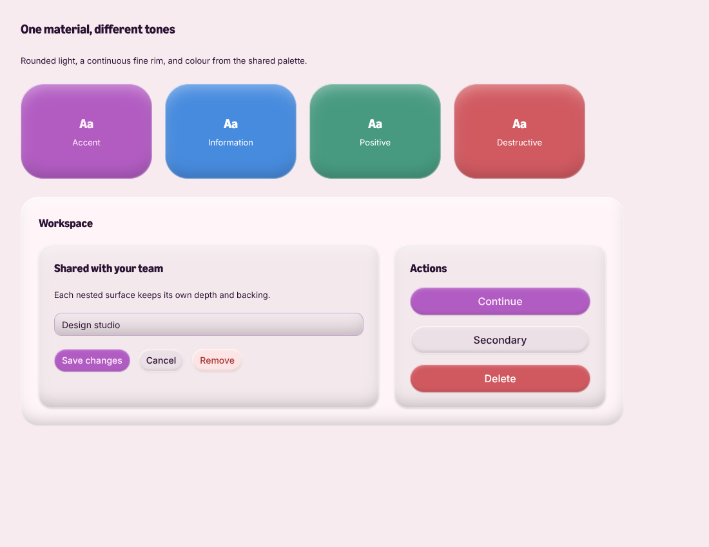
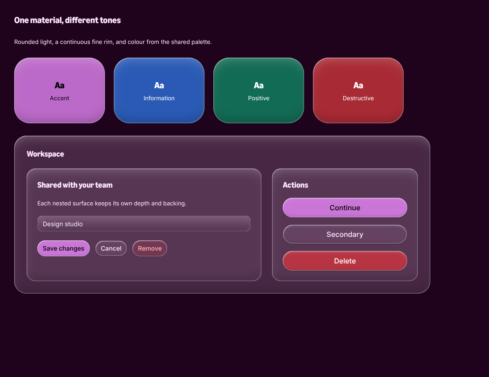
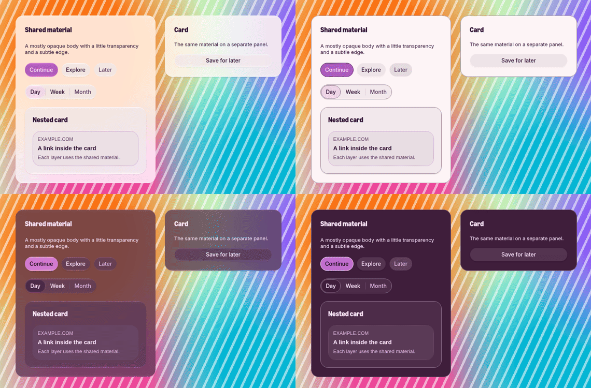
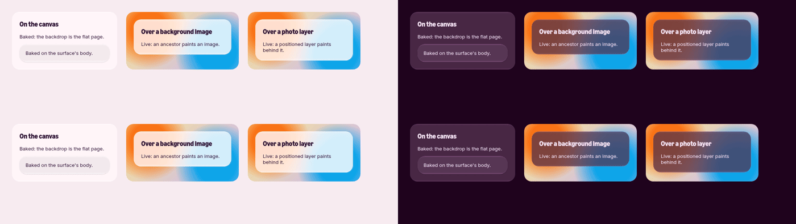

# Surface

`Surface` is a passive container. It owns material, not interaction, navigation or spacing. It is distinct from `surfaces`, Bloom's imperative dialog and sheet API.

```tsx
import { Surface, Button } from '@oxy.so/bloom';

<Surface style={{ padding: 24 }}>
  <Button>Continue</Button>
</Surface>
```

Surface has one shared material: a frosted, translucent body with a rounded bevel and a fine luminous rim around its full silhouette. There is no material selector. Opaque semantic fill colours receive 72% opacity on web, so the frosted backdrop shows through; caller-supplied alpha remains explicit. With no fill override, a Surface on the page uses the card role, and a nested Surface derives its fill from the actual parent. `radius` defaults to 20. Geometry precedence is explicit `radius` → resolved `style.borderRadius` → family default, shared with Card and BlurIsland. Host and paint always receive the same resolved radius, including percentage style values. Use `radius` or `style.borderRadius` to set native clipping, rather than a class utility the inner paint cannot inspect. `className` belongs to the root layout node; padding, size and layout remain caller-owned. `children`, `accessibilityLabel` and `testID` pass through.

Surface publishes its resolved base fill to `SurfaceLevelProvider` and `--bloom-surface`, so nested cards, fields and other controls read the same backing that it paints. The bevel and rim decorate this base; they do not create another level. Stepping is based on the actual fill even beyond named level 3. Explicit `fill` takes precedence over `style.backgroundColor`; both are respected and published. Material fills are composited onto the declared parent, an estimate rather than a measurement of the blurred backdrop.

`Surface` has no press, disabled, loading or business state. Controls such as Button own those states and consume the **same paint** directly: `SurfacePaint` for universal components and `surfaceMaterialCss` for web roots. These are internal implementation primitives, not alternate public components. Button keeps its single interactive root without wrapping it in another Surface.

The shared implementation lives in `surface/optics.ts` (body-filter and lighting recipes), `surface/shared.ts`, `SurfacePaint.tsx` and `web-material.ts`. On web the shape is always the host's own border radius, so material and host cannot disagree, whatever the radius (capsules, per-corner radii, percentages). Two pseudo-elements paint it:

- `::before` is the body: the backdrop blurred (24px), saturated, flattened and brightened under the tint. This is the material's only backdrop-filter pass.
- `::after` paints the lighting itself: three fine inset rim/reflection shadows around the silhouette, then two broader inset shadows for an upper-left highlight and a lower-right shade. It has no background, mask, filter or backdrop filter. The body colour shows through the rounded bevel; the lighting never paints an outer halo.

`surfaceLighting(optics, rim, sheen)` joins the two optional shadow groups. Hosts set `--bloom-surface-lighting` and the body filter through `surfaceOpticsVars(optics, rim, sheen)` on every painting element, so none inherits an enclosing surface's recipe. Radius is inherited directly by the paint, not passed to the optics. A host clips with `overflow: clip; overflow-clip-margin: 1px` rather than `hidden`: an exact clip cuts the layers' antialiased edge and Chromium does not antialias it. Web keeps circular corners. Historical hazard: Chromium removed the previous renderer's masks inside non-round `corner-shape` clipping. No blend modes either: a sibling with `mix-blend-mode` switches the body's backdrop filter off.

Native paints one view: tint as `backgroundColor`, with the same five inset `boxShadow`s for the complete rim and broad bevel. Never replace them with an `experimental_backgroundImage` gradient: React Native's parser drops a whole gradient for one `calc()` stop (every native surface lost its glow that way), and a gradient with fixed `px` stops crashes the Android emulator's SwiftShader renderer (a SIGSEGV in its render thread on the first frame, measured with six stops and with four). No in-flow native surface has a `BlurView`, and no Android one at all (see *iOS: the system's material under floating surfaces* below). A surface's own outer shadow belongs on the outer node; do not clip the native outer node if it needs one.

`Surface` has no press, disabled, loading or business state. Controls such as Button own those states and consume the **same paint** directly: `SurfacePaint` for universal components, `surfaceMaterialCss` and `useSurfaceMaterial` for web hosts. A `Screen` inside a painted surface leaves its canvas transparent, so the surface's material and edge stay visible.

## Bevel lighting and composition

The lighting belongs to the shared optics, not to an action palette. Button
tones, semantic foreground pairs, explicit alpha, parent backing and depth
retain their existing owners. The highlight, inner shade and reflected edge
make small controls visibly rounded while large panels retain a quiet centre.
`SurfacePaint rim={false}` removes the fine rim independently of the broad
bevel; `sheen={false}` removes that bevel independently of the rim. Plain and
flat components remain unpainted. Responsive ContentPanel framing gates the
whole lighting recipe with one CSS variable.

Button uses `controlReliefScale(height, lineHeight)` to derive a vertical
content inset from its resolved size, density and text geometry. The shared
material helper scales the broad bevel's offsets, blur and spread to that
space, keeping its light/shade strengths and fine rim.
This keeps the broad lighting near the edge of short buttons instead of
covering their label area. It is an internal paint input, not a public material
variant; semantic palettes, control dimensions and published backing retain
their existing owners. Arbitrary height or line-height overrides in `style`
or `className` are not measured; this scale follows the resolved built-in
Button geometry and introduces no layout observer.

Reduced transparency removes all decorative lighting on both platforms;
increased contrast adds the existing contrast hairline to the opaque body.
The web's baked path replaces only the body colour. The lighting layer uses
the same inset-shadow recipe in live and baked rendering, without another
backdrop pass. Native uses those same shadows, never a gradient or an
additional blur. OxyOS renderers that do not implement box shadows retain
their current tint fallback.

This revised renderer remains pending release validation. Chromium 153's
baked-material gate passes the dark fixtures and all outline comparisons, but
the light fixtures still differ by up to 4 RGB levels against the unchanged
limit of 2. A 72-case button comparison found no new crossings below 4.5:1
after scaling the bevel; existing light accent/danger combinations remain
below that floor. Twelve reduced/increased-contrast interaction checks retain
opaque state colours without lighting or filters. Native device appearance
and dense-view performance still need verification. Jest verifies paint and
composition contracts, not visual equivalence or device performance.

The shared `surfaceLightingFills` bounds let components account for the bevel
when they paint additional artwork beneath text. ProOfferCard combines those
bounds with its own artwork colours before choosing its caption through
`quietTextOver`, rather than reusing the page's secondary text colour.

The `RoundedMaterial` Storybook example shows semantic fills and nested controls:





## iOS: the system's material under floating surfaces

On iOS a surface that floats over content (`SurfacePaint floating`) draws the
system's material under its tint, as the web's material does: a
`UIVisualEffectView` (expo-blur's `BlurView`, `surface/SurfaceBlur.tsx`) with the
thinnest system material, light or dark by the theme, then the tint at the web's
72% (`SURFACE_TINT_OPACITY`; an explicit alpha is kept), then the edge light, all
clipped to the surface's shape. The blur and its saturation are the platform's;
the tint and the edge stay Bloom's. The floating surfaces are an equality in
`surface-ios-blur.test.tsx`, each with its reason: `BlurIsland`, the tab bar's
capsule (so `BottomBar`'s), `BottomSheet`'s panel, `Dialog`'s panels and centred
card, toasts, native tooltips and the composer's popover.

- **In-flow surfaces stay one opaque view.** A card in a feed has nothing moving
  behind it, and a `UIVisualEffectView` per row is an offscreen pass per row.
- **Android and OxyOS never blur a surface.** A `BlurView` inside its own blur
  target crashes Android's render thread ([Blur](./blur.mdx)); their floating
  surfaces stay opaque, so iOS and Android floating surfaces differ by design.
- **A `composite` fill keeps the opaque paint:** its token is made to read over
  the surface.
- **With transparency reduced** (or contrast increased) the floating surface is
  the opaque view every other native surface paints, with no blur mounted.
  All paint reads the switch to suppress relief; only floating iOS surfaces
  mount a system blur.
- The colour a floating surface publishes to its content stays its opaque fill:
  the text on it is measured against what reduced transparency paints exactly.

Not run on a device here: the gate is the Jest suite above, and the checklist
for a device is the striped-backdrop scenario in
[the study](./surface-material-study.mdx) (phase 3).

## Reduced transparency

With `BloomProvider reduceTransparency`, a platform appearance that asks for it
(the `appearance` capability), the system's own setting (iOS Reduce
Transparency; the browser's `prefers-reduced-transparency: reduce`), or with
contrast increased (below), no surface filters its backdrop. The body
paints opaque and the decorative rim and bevel are gone. The opaque
colour is the one the surface already publishes to its content (its tint
composited onto its parent, `resolveSurfaceMaterial().solidFill`), so the text and
controls on it are measured against what is painted. It is the colour native
paints, so web and native look the same.

The provider marks the document with `data-bloom-transparency="reduced"`, beside
the `dark` class, and `surfaceMaterialCss` carries the rule for both that
attribute and the media query, so every host follows it with no prop of its own.
Each host sets `--bloom-surface-solid` on itself (`transparent` when it paints no
material), so none inherits an enclosing surface's. Historical measurement
with the previous renderer on a Chromecast (Chrome 90) over a slowly moving
photo: 7 fps with a backdrop filter per card, 16 without.

The provider resolves the switch once (the prop, the platform's appearance or the
system's setting) and publishes it twice: the document attribute for the material's CSS, and
`useReducedTransparency()` for native lighting and what blurs in JavaScript. Every material host
follows the attribute with nothing of its own (Button, Card, Sidebar,
`BlurIsland`, floating panels, the window controls' bubbles and plate). The rest
read the hook:

- `Backdrop`'s blur becomes its tint alone (`blurTintColor`: the colour expo-blur
  lays over the blur, Android's on Android and OxyOS, the web's elsewhere) under
  the same dim. A dimming backdrop stays a dim, never an opaque sheet over the
  app, as a Mac keeps the dimming behind a sheet.
- `ProgressiveBlur`'s native layers become their tint; the web fork drops its
  backdrop filter and keeps its masked tail.
- The hand-made web blurs paint opaque: the spoiler cover takes native's opaque
  scrim, the AI chat's frosted actions and frame toast their ink, the model
  picker's scroll fade its wash alone, the radar chart's centre disc its inner
  surface.

`reduced-transparency-census.test.ts` keeps it one switch: a file that sets a
backdrop filter or imports `expo-blur` reads the hook or is classified with a
reason. The material's CSS also carries the browser's media queries itself, so
it is right from the first paint, before any script has run; the hook follows
the same queries once the provider has mounted.

## Increased contrast

With `BloomProvider increaseContrast`, a platform appearance that asks for it
(`increaseContrast` in the `appearance` capability's state), or the system's own
setting (iOS Increase Contrast, Android's high-contrast text, the browser's
`prefers-contrast: more` or `forced-colors: active`), transparency is reduced as
above **and** every surface edges its opaque body with a 1px hairline instead of
the edge light. It is a separate switch from reduced transparency: reducing
transparency alone keeps the surfaces edgeless, as a Mac does.

The hairline is `surfaceContrastEdge(body, text)`: the quietest mix of the body
toward the theme's text that still holds 3:1 against the body (WCAG 1.4.11,
`SURFACE_CONTRAST_EDGE_RATIO`). It is measured against the opaque body the
surface publishes, so it holds on every level, in every preset, light and dark.
A host that draws its own border (`SurfacePaint rim={false}`, an outlined
`Button`) keeps that border as its edge and draws no hairline.

- **Web.** The provider writes `data-bloom-contrast="more"` beside
  `data-bloom-transparency="reduced"`; `surfaceMaterialCss` carries the rule for
  the attribute and both media queries. The `::after` layer drops its decorative
  shadows and draws `border: 1px solid var(--bloom-surface-hairline)`.
  Each host sets `--bloom-surface-hairline` on itself, as it sets
  `--bloom-surface-solid`. In `forced-colors` the browser recolours that border
  to the system's own; the line stays.
- **Native.** `SurfacePaint` drops the inset shadows of the edge light and draws
  the hairline as a 1px border on its paint view, so every renderer draws it,
  the OxyOS host included. The body was already opaque.
- `useIncreasedContrast()` reads the switch; `useReducedTransparency()` is true
  whenever it is.



Gates: `increased-contrast.test.tsx` (the iOS and Android settings as they
change, the prop, the native hairline, the 3:1 floor over every preset's card
and page in both modes) and `increased-contrast.web.test.tsx` (the document
attributes, the media queries from the first render, the CSS rule, the hairline
each host sets).

## Baked material (web)

Where everything behind a material host is one flat colour, blurring it changes
nothing, and the rest of the material's filter (saturate, contrast, brightness)
is arithmetic on that colour. So the web computes the body once and paints it
as a plain colour, with no backdrop filter for the compositor to run on every
frame: the host is marked `data-bloom-material="baked"` and carries its body in
`--bloom-surface-baked-body` (`surface/baked-material.ts`). Only `::before`
changes; `::after` keeps the same self-painted rim and bevel.
`scripts/verify-surface-baked-material.mjs` compares the fixtures baked and
live in both modes and requires pixels to stay within 2 RGB levels outside
a host's antialiased outline, with the existing separate outline allowance.
The revised renderer must pass that gate before its parity is established.

The decision is made per instance, from the page, after the host has painted
once live: the same Card sits on a page's canvas in one place and over a photo
in another, which no list of callers can tell apart. Walking up from the host,
the first thing that paints decides:

- an element with an opaque, flat background (no image): bake on it;
- a material host already baked (parents are done first), without decorative
  lighting: bake on its flat body;
- anything else stays live: a translucent or image background, a live material
  host, an element that floats out of the flow (`absolute`, `fixed`, `sticky`)
  or that is a backdrop root, and the host itself floating.

A parent's decorative rim and bevel are not a flat colour. A child directly
backed by illuminated material stays live, even when that parent is baked.
This applies throughout the parent: a position-based centre exception could
become incorrect after layout moves the child toward the lit edge. No geometry
observer or new position cache is introduced. An explicit opaque, flat backing
inside the nested tree can still provide a known colour and allow its children
to bake. This intentionally reduces nested baking coverage compared with the
previous renderer; its performance tradeoff needs fresh measurement. The
pixel gate's tolerances remain unchanged.

On the way, a positioned or transformed earlier sibling that overlaps the host
keeps it live: it would paint behind it. A host starts live and is baked in the
next frame, so a wrong guess could only cost the performance it saves, never
show a wrong colour first. A host reruns when its fill or look changes (it
unbakes before that commit paints), and every host when the document's theme,
transparency or contrast changes. With transparency reduced nothing bakes: the
bodies are already opaque.

Registered: `Surface`, `SurfacePaint` (Card, Sidebar and the other families
that use it) and `ContentPanel`. A `SurfacePaint` whose fill animates between
states (`transition`: fields, chips, switches) and `Button` stay live: a baked
body does not transition with the tint. Floating panels, menus, toasts and
dialogs float, so they stay live by the rule.

Button hover, press and disabled tint changes paint `::before`, the body layer.
The self-painted `::after` lighting stays background-free in every state, so a
state does not add a second tint over the bevel. State-selected opaque body
and hairline variables follow the same palette when transparency is reduced
or contrast is increased.



`data-bloom-material-bake="off"` on the root keeps every host live: the
control the pixel and performance checks compare against, never a second
material. The following **historical measurement of the previous masked-rim
renderer** is not a measurement of the revised inset lighting.
**System / Composition / Dense Feed** (100 posts,
`scripts/measure-surface-feed.mjs`, headless Chrome 146 on a development build,
2 s of scrolling, two runs each): live, 300 hosts filter their backdrop, 64 and
87 frames, 95th percentile 33 and 50 ms, 32 and 49 frames over 32 ms; baked,
100 hosts still filter (the buttons), 120 frames each, 95th percentile 16.8 ms,
none over 32 ms; with every filter off, 120 and 121 frames. Software rendering:
the ratio, not the numbers, is the evidence.

## Backdrop roots: never fade or filter a material host or its ancestors

In Chromium an element with `opacity` below 1, any `filter` (`blur(0px)` included: only `none` is safe), a `mask`, a `clip-path`, a `mix-blend-mode` or a `backdrop-filter` of its own is the **backdrop root** of everything under it. A material host on or under one blurs only what that element painted: its body turns flat for as long as the trigger lasts, then pops back. Self-painted lighting does not repair a missing backdrop. Historical measurements with the masked-rim renderer behind a striped page: a dialog's stripe contrast jumped to full (255) the instant it began closing, a tooltip rested at 66 because its entrance ended on `filter: blur(0px)`, and a menu flickered on every open and close.

So a surface that paints the material appears, leaves and dims through its **presence**, a number from 0 to 1 (`surface/use-surface-presence.ts`):

- The host moves and scales with `transform` only.
- Its layers fade through `--bloom-surface-presence` over `--bloom-surface-presence-ms` (`surfacePresenceStyle` on the host, or `SurfacePaint presence`/`presenceMs`). An element's own opacity does not cut its own backdrop filter, so `::before`/`::after` may fade; both variables inherit, so a material host nested in the content fades with it.
- `useSurfacePresenceContent(host, { presence, duration, blur })` fades the content piece by piece: each subtree that holds no material host gets its own opacity (and blur, which lands on `none`), and the walk goes into the ones that do, so no material host ever has a fading ancestor. A nested host that is gone drops its shadow too. Its `exit` option fades a surface whose exit plays on a detached copy after it unmounts (a Reanimated `exiting`, as the toast's).
- Content can change in the middle of a fade, and React may put new content into a node it already faded. A piece that comes to hold a material host is handed back before the frame paints, and its own pieces take the presence instead. Class changes count. This also covers a presence that is still rising to 1. Measured on a hover card whose profile loaded while it closed: the reused node kept fading over the Follow button, and that button drew flat for the rest of the close. Gates: the `content that changes while a surface fades` tests and the `base-hover-card--loads-while-closing` story, which loads two frames into its close.
- A box that holds a material host and fades must not paint its own background: give the fill its own layer (the sticky media bar does), since the walk fades the subtrees around a host, not the box that holds it.
- A presence can follow a motion the browser already runs: set `--bloom-surface-presence: var(--progress)` and `--bloom-surface-presence-ms: 0ms` on a non-material ancestor, where `--progress` is a registered `<number>` carried by a CSS transition (`motionCss`), and the layers track it frame by frame on the same curve, a spring's overshoot included. A docked region's fading peek does this (`--bloom-nav-peek-fade`, [App shell](/docs/bloom/main/app-shell)) and fades its content with `useSurfacePresenceContent` over the same spec.
- `useEnteredPresence(open)` gives a surface that mounts already open (tooltip, toast, hover card) one painted frame at 0 to fade in from.
- `useSurfacePresence(presence)` returns the `ref` and `style` for a host whose presence is a plain number.
- Disabled, pressed and closed states are presences below 1 that stay (a pressed Card is 0.85, a disabled one `DISABLED_OPACITY`), or dim their content, strokes and tint colours.
- Hover and focus reveals use `surfaceRevealCss({ scope, shown })`: the revealing box publishes presence 0 or 1, the revealed control's content and shadow fade on their own. Never `opacity: 0` on the box that holds the control.

Native has no backdrop filter, so native hosts keep fading and dimming themselves with `opacity`. A host at full presence gets no `opacity` at all, so a caller's own `opacity` (a Card at `style={{ opacity: 0.4 }}`) still applies.

Gates: `src/__tests__/backdrop-root.web.test.tsx` renders every file that paints the material at rest, pressed, disabled, opening and closing, and fails on any trigger on a host or an ancestor (inline, cascaded, a `@keyframes` that sets one, or a `:hover`/`:focus` rule that could); its census fails on a new painter that is neither rendered nor classified. `scripts/verify-backdrop-root.mjs` walks every Storybook story in Chromium, finds material hosts by their computed `::before`/`::after` backdrop filter, and samples every frame at rest, while hovering and pressing, and while overlay families open and close.


### Native presence cost

Native surfaces dim their host directly. DOM content-presence bookkeeping and
host observation belong only to web; the platform is selected once when the
module loads. Card preserves its forwarded native ref and press/disabled
opacity, while web retains merged host observation and material-safe fading.
SurfacePaint subscribes to the backing fill only on web, where tint compositing
uses it. Keep native feed measurements and the web backdrop-root regression
when changing these boundaries.
